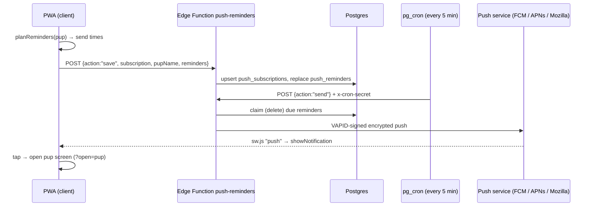

# 12 — Hungry pup reminders (push notifications)

Opt-in notifications that bring players back when their pup gets hungry: "🐶 Biscuit is getting hungry" and "🥺 Biscuit is starving!".

## Decisions

- **Opt-in only.** It's off by default. Players turn it on in **Settings → 🔔 Hungry pup reminders**, or from a one-time card on the pup screen. The browser permission prompt only appears after a tap.
- **Two reminders per hunger cycle at most:** when fullness drops below **40** (Hungry) and below **15** (Starving), matching `moodFor` in `src/core/pet/pup.ts`.
- **Quiet hours from 22:00 to 08:00 in the player's local time.** A reminder that falls inside quiet hours moves to 08:00. If both would land on the same morning, only "Starving" is sent.
- **Server Web Push.** The browser can't wake a closed PWA on a timer, so a server has to send the push. We use a Supabase Edge Function plus `pg_cron`, on the same stack as the social plan in [11-social-plan.md](11-social-plan.md).
- **No accounts and no personal data.** The server stores only the push endpoint and its keys, the pup's name (for the message text), and the planned send times.
- **Home-screen widgets are skipped.** A PWA can't add Android or iOS home-screen widgets; that needs native wrappers (Kotlin `AppWidget`, Swift WidgetKit). The only PWA "widgets" are Windows 11 Widgets Board manifests, which don't help on mobile.

## Platform support

| Platform | Works? |
|---|---|
| Android (Chrome, Edge, Samsung Internet, Firefox) | ✅ In the browser or installed |
| iOS / iPadOS 16.4+ | ✅ **Only when installed** (Share → *Add to Home Screen*) and opened from the icon. In Safari tabs, the toggle explains this. |
| Desktop Chrome / Edge / Firefox / Safari | ✅ |
| Permission denied / unsupported browser | The toggle shows why and stays off |

## How it works



- Hunger decay is deterministic: fullness falls 100/30 per hour from `fullnessAt`. The client can therefore compute exact send times (`src/core/pet/reminders.ts`), and the server never needs the game rules.
- Every time fullness, `fullnessAt` or the pup's name changes (feeding, time travel, a save import), the app re-syncs and replaces the schedule after a 1.5 s debounce. Feeding pushes reminders later.
- Turning reminders off, resetting progress, or a denied permission unsubscribes and calls `remove`.
- Opening the app closes any reminder notifications still showing.
- The server skips reminders more than 6 h overdue (for example after downtime). It removes subscriptions that the push service reports as gone (404/410).
- Push endpoints are allowlisted to the known push services (prevents SSRF). Payloads are size-checked, and `send` requires the cron secret.

| File | Role |
|---|---|
| `src/core/pet/reminders.ts` | Pure planner: thresholds, quiet hours, schedule |
| `src/net/push.ts` | Subscribe/unsubscribe, status detection, calls to the function |
| `src/ui/hooks/usePupReminders.ts` | Auto-sync hook (mounted in `App`) and the toggle hook |
| `public/sw.js` | `push` and `notificationclick` handlers |
| `supabase/functions/_shared/pushReminders.ts` | Validation, endpoint allowlist, message text (shared with tests) |
| `supabase/functions/push-reminders/index.ts` | Edge Function: `save`, `remove`, `send` |
| `supabase/migrations/20261013000000_push_reminders.sql` | Tables (RLS on, no client access) and the cron job |

When `VITE_SUPABASE_URL` or `VITE_VAPID_PUBLIC_KEY` is missing, all reminder UI is hidden and the game works as before.

## Setup (one time)

You need the [Supabase CLI](https://supabase.com/docs/guides/cli) and a Supabase project (the free tier is enough). If the CLI isn't installed, put `npx` in front of every `supabase` command below (for example `npx supabase link ...`), or install it with Scoop on Windows or Homebrew on macOS. Global npm installs (`npm i -g supabase`) aren't supported.

1. **Link and migrate.** This creates the tables and the cron job, and enables `pg_cron` and `pg_net`.
   ```sh
   supabase login
   supabase link --project-ref <project-ref>
   supabase db push
   ```
2. **Generate keys and a cron secret.**
   ```sh
   npm run vapid-keys        # prints VAPID_PUBLIC_KEY and VAPID_PRIVATE_KEY
   ```
   Choose a long random string to use as the cron secret, for example `openssl rand -hex 32`.
3. **Create the Vault secrets used by the cron job.** Run this in the SQL editor of the Supabase dashboard:
   ```sql
   select vault.create_secret('https://<project-ref>.supabase.co', 'project_url');
   select vault.create_secret('<cron-secret>', 'push_cron_secret');
   ```
4. **Set the function secrets and deploy.**
   ```sh
   supabase secrets set VAPID_PUBLIC_KEY=<public> VAPID_PRIVATE_KEY=<private> \
     VAPID_SUBJECT=mailto:you@example.com PUSH_CRON_SECRET=<cron-secret> \
     ALLOWED_ORIGINS=https://brent-broeckx.github.io
   supabase functions deploy push-reminders
   ```
   `config.toml` sets `verify_jwt = false`, because there are no accounts and the function validates every request itself.
5. **Configure the web build.** In GitHub → *Settings → Secrets and variables → Actions → Variables*, add:
   - `VITE_SUPABASE_URL` = `https://<project-ref>.supabase.co`
   - `VITE_SUPABASE_PUBLISHABLE_KEY` = the project's publishable key (`sb_publishable_...`, from Project Settings → API Keys)
   - `VITE_VAPID_PUBLIC_KEY` = the public key from step 2

   The next deploy to `main` turns the feature on.

> ⚠️ Never put the VAPID **private** key, the service-role key or the cron secret in a `VITE_*` variable. Those values are bundled into public JavaScript.

## Testing locally

The service worker only registers in production builds, so preview a build:

```sh
cp .env.example .env.local   # fill in the three VITE_* values
npm run build && npm run preview
```

Open the preview URL, turn on reminders, then use the dev-only time travel or wait. To trigger sending right away instead of waiting for cron:

```sh
curl -X POST https://<project-ref>.supabase.co/functions/v1/push-reminders \
  -H "x-cron-secret: <cron-secret>" -H "content-type: application/json" \
  -d '{"action":"send"}'
```

Due reminders appear in the `push_reminders` table (Table editor). Cron runs are listed in `cron.job_run_details`.

Unit tests: `npx vitest run src/core/pet/reminders.test.ts`.
